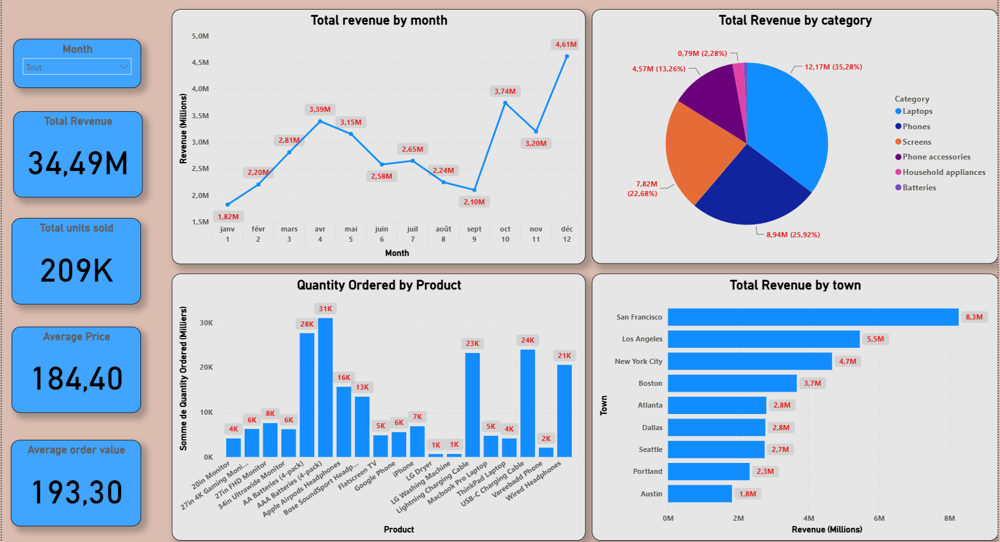

# Distribution Retail — Tableau de bord décisionnel & Performance des ventes

Tableau de bord interactif Power BI conçu pour analyser la performance commerciale et financière des ventes de matériel électronique aux États-Unis. Le projet suit l'évolution du chiffre d'affaires, la saisonnalité, le panier moyen client et la répartition géographique sur 9 grandes métropoles.



---

## 1. Contexte métier & Objectifs analytiques

Le pilotage commercial et le contrôle de gestion nécessitent une visibilité précise sur la dynamique des ventes afin d'optimiser les stocks, d'allouer les budgets marketing et d'anticiper les flux financiers.

Ce projet répond à plusieurs enjeux stratégiques :
* **Moteurs de revenus :** Quelles sont les catégories et lignes de produits qui génèrent la majorité du chiffre d'affaires ?
* **Saisonnalité :** Comment évoluent les volumes de vente au cours de l'année et quelles sont les périodes de pointe ?
* **Dynamique du panier d'achat :** Quels sont le panier moyen (AOV) et le nombre moyen d'articles par commande (UPO) ? Que révèlent-ils sur les ventes croisées (*cross-selling*) ?
* **Poids géographique :** Quelles métropoles représentent les principaux centres de profit ?
* **Profil horaire de la demande :** À quelles heures de la journée les commandes atteignent-elles leur pic ?

---

## 2. Indicateurs clés de performance (KPIs)

Le tableau de bord suit 5 indicateurs opérationnels et financiers majeurs :

| Indicateur | Valeur | Interprétation analytique |
| :--- | :--- | :--- |
| **Total Revenue** | **34,49 M$** | Chiffre d'affaires global brut généré sur l'année. |
| **Total Units Sold** | **209 K** | Volume total d'unités vendues, toutes catégories confondues. |
| **Average Price** | **184,40 $** | Prix unitaire moyen d'un article vendu. |
| **Distinct Orders** | **178,44 K** | Nombre total de commandes uniques finalisées. |
| **Units Per Order (UPO)** | **1,17** | Ratio d'articles par commande (achats très majoritairement unitaires avec un faible niveau de vente croisée). |
| **Average Order Value (AOV)** | **~193,30 $** | Panier moyen par commande (34,49 M$ / 178,44 K commandes). |

---

## 3. Principaux constats analytiques

### A. Mix produit & Concentration du chiffre d'affaires
* **Prédominance du matériel à forte valeur :** Les ordinateurs portables (*Laptops*) représentent **35,28 % (12,17 M$)** et les téléphones **25,92 % (8,94 M$)** du chiffre d'affaires. À eux seuls, ces équipements génèrent plus de **61 %** des revenus.
* **Asymétrie volume / valeur :** Les piles (AAA/AA) et les câbles de charge dominent largement les volumes (20K à 31K unités chacun), mais leur apport financier reste modeste. Inversement, le matériel informatique tire la croissance du CA malgré des volumes plus faibles.

### B. Saisonnalité & Trajectoire financière
* **Pic de fin d'année :** Une forte accélération est visible au 4ᵉ trimestre, avec un sommet en **décembre à 4,61 M$** (achats des fêtes et clôtures budgétaires), comparé à un point bas en **janvier à 1,82 M$**.
* **Rebond printanier :** Un palier de reprise s'observe entre mars (2,81 M$) et avril (3,39 M$).

### C. Répartition géographique
* **Domination de la Côte Ouest :** **San Francisco** est le premier marché avec **8,3 M$** de revenus, suivie de **Los Angeles (5,5 M$)** et de **New York (4,7 M$)**.
* L'activité commerciale se concentre principalement dans les grands bassins économiques et technologiques de Californie, du Nord-Est et du Texas.

### D. Profil horaire des commandes
* **Distribution bimodale (deux pics d'activité) :**
  * Pic du midi : **12h00 – 13h00** (~14,2 K commandes / 2,32 M$ de CA).
  * Pic du soir : **19h00 – 20h00** (~14,5 K commandes / 2,41 M$ de CA).
* Les commandes chutent fortement entre 01h00 et 06h00 (< 1,5 K commandes/heure), confirmant que les campagnes promotionnelles et l'engagement client sont optimaux durant la pause déjeuner et après la journée de travail.

---

## 4. Architecture technique & Méthodologie

* **Outil BI :** Microsoft Power BI Desktop
* **Modélisation :** Schéma en étoile reliant les tables de dimensions (Calendrier, Clients, Villes, Produits) à la table de faits des transactions.
* **Mesures DAX :**
  * Agrégations de base (`SUM`, `DISTINCTCOUNT`).
  * Calculs de ratios et paniers moyens avec sécurisation contre la division par zéro (`DIVIDE`).
* **Conception visuelle :** Cartes KPI, filtres synchronisés, cartographie géographique et graphique combiné double axe (Quantités commandées vs Chiffre d'affaires).

---

## 5. Structure du dépôt

```text
us-electronics-sales-bi-dashboard/
├── README.md                           # Documentation détaillée du projet
├── sales_analysis_composants.pbix       # Fichier source Power BI Desktop
└── images/
    └── dashboard_overview.png           # Capture propre du tableau de bord
